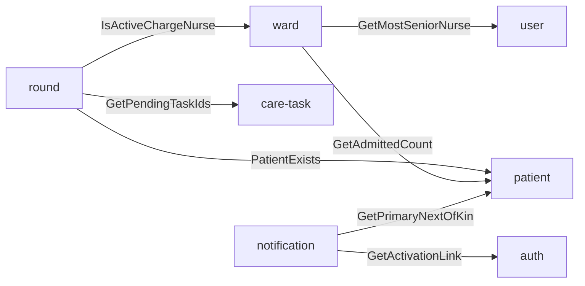
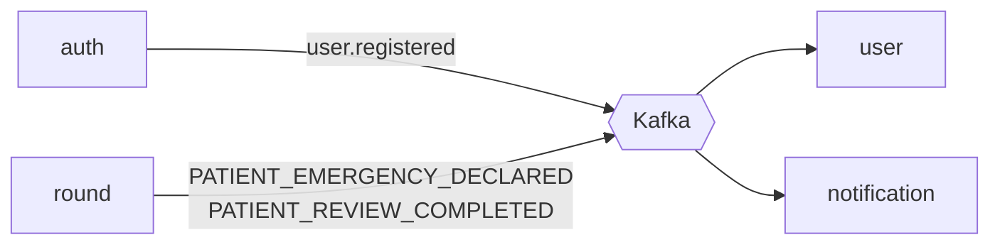

## The problem

A hospital ward runs on coordination. Nurses clock in to shifts and a charge nurse has to be in
charge at all times. Doctors do ward rounds and leave notes, which create care tasks. Emergencies
have to reach the right people immediately. On many wards this still lives on paper and in
phone calls. When one part fails, such as a notification that never arrives, the consequences
are clinical.

## What I built

A backend split into seven independently deployable Spring Boot services, each owning its own
PostgreSQL database:

| Service | Responsibility |
|---|---|
| **auth** | Login, refresh/logout, admin-created accounts with activation links, email change, password change. Publishes the public signing key at `/.well-known/jwks.json`. |
| **user** | Staff profiles. Builds its local user record from `user.registered` events and answers seniority queries. |
| **ward** | Wards, shift definitions, attendance (clock in/out), handovers with sign-off, staffing requirements, charge-nurse assignment and automatic charge succession. |
| **patient** | Patient admissions and status, next of kin, ward census. |
| **round** | Ward rounds, per-patient reviews, clinical notes with commit and addenda, emergency episodes. |
| **care-task** | Care plans, care protocols and care tasks with a lifecycle (start, complete, cancel, refuse). |
| **notification** | Consumes domain events and sends activation, review and emergency notifications. |

## Architecture

**Synchronous queries (gRPC):**

**Asynchronous events (Kafka, published through an outbox):**

Each service has its own database, and no service reads another's tables. Services
query each other synchronously over gRPC when they need an answer now, such as *is this nurse
the active charge nurse?* They publish facts asynchronously over Kafka when others need to react,
such as *a patient emergency was declared*.

## Key engineering decisions

**Transactional outbox instead of dual writes.** Writing to the database and publishing to Kafka
as two steps can leave them out of sync if the process dies in between. So the auth and round
services write events to an `outbox` table in the same transaction as the business change. A
scheduled publisher then drains the table in batches of 100 every five seconds. Each event carries an
idempotency key, and the notification service records what it has already sent, so a redelivered
event doesn't notify anyone twice.

**Retries with exponential backoff, then a dead-letter state.** Failed sends are retried with
backoff (5s × 2ⁿ). After five attempts the event moves to `DEAD_LETTER` rather than being lost. In the auth service,
admin endpoints list dead letters and retry them manually.

**A circuit breaker around Kafka.** After 10 consecutive failures the publisher stops polling. That
avoids hammering a broker that's down and filling logs. A separate job pings Kafka every minute
and closes the circuit when it recovers.

**Asymmetric JWTs (RS256) with a JWKS endpoint.** Only the auth service holds the private key.
Every other service verifies tokens locally using the public key. A token can't be forged by
compromising a downstream service, and there's no call to auth on every request.

**gRPC for internal queries.** The contracts are explicit `.proto` files, so a request is typed
end to end, unlike JSON over internal HTTP.

**Scheduled charge succession.** A ward must always have someone in charge. A scheduler detects
vacancies and, when a claim window expires, resolves succession using the most senior nurse on
shift (from the user service over gRPC).

## Trade-offs

- Seven services and seven databases are a lot to run locally. I accepted that operational cost
  because the domains (auth, staffing, clinical notes, tasks) change at different rates and have
  different data-sensitivity rules.
- The outbox circuit breaker is hand-rolled for clarity. In a larger system I'd use Resilience4j.
