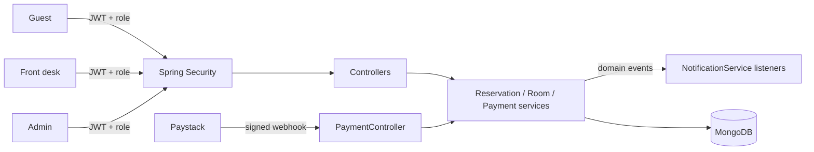

## The problem

A hotel needs different people to do different things with the same bookings. Guests book and
view their reservations. Front-desk staff check guests in and out and manage room status.
Admins manage staff, rooms and reports. Payments come in asynchronously from a payment provider.

## What I built

- **Role-based access control** with three roles. Each role has its own route prefix
  (`/api/admin/**`, `/api/frontdesk/**`, `/api/guests/**`), enforced in Spring Security.
- **Reservations:** booking, check-in, check-out, cancellation rules, and room availability and
  maintenance status.
- **Payments:** a Paystack webhook endpoint that verifies the `x-paystack-signature` HMAC-SHA512
  of the raw payload before trusting the event.
- **Notifications:** booking, check-in, check-out, cancellation and reminder events are published
  with Spring's `ApplicationEventPublisher` and handled by listeners. Reservation logic doesn't
  need to know how guests are notified.
- **Reports** for admins, and readable references for guests, reservations and staff.

## Architecture

## Key engineering decisions

- **Verify webhooks before trusting them.** The signature is computed over the raw request body,
  so a forged "payment succeeded" call is rejected.
- **Atomic room numbering.** Room numbers come from a counter document incremented with
  `findAndModify` + `$inc`, so two concurrent "add room" requests can't get the same number.
- **Events decouple side effects.** Notifications listen for domain events instead of being called
  inline from booking code.
- **Tested.** About 50 tests cover the services and booking rules.
