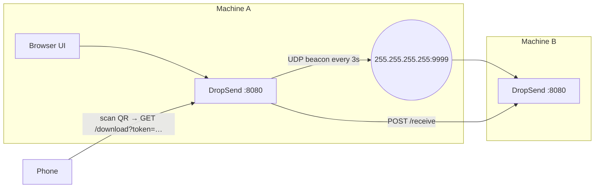

## The problem

Moving a file from a laptop to a phone, or between two laptops in the same room, often still
means emailing it to yourself or uploading it to a cloud drive. That's slow, it needs internet
access, and the file leaves the building.

## What I built

A single Go program that anyone on the same Wi-Fi can open in a browser:

- **Upload and share:** drop a file and get a download link plus a QR code to scan from a phone.
- **Find peers automatically:** other machines running DropSend show up by name, with no IP
  addresses to type.
- **Send to a peer:** push a file straight to another DropSend instance, where it appears in their inbox.
- **See the network:** a view of devices on the local subnet (from the ARP table), marking which
  ones are running DropSend.

It's also published as a Docker image on Docker Hub.

## Architecture

## Key engineering decisions

**UDP broadcast for discovery.** Every instance broadcasts a small JSON beacon (name and IP) every
three seconds and listens on the same port. A cleaner goroutine drops peers not heard from in ten
seconds, so the peer list reflects who is actually online, with no central server.

**Unguessable, expiring links.** Each upload gets a random token. Downloads require the token
*and* a matching file name, and links expire after one hour. Anyone on the network can reach the
port, so knowing it isn't enough to fetch other people's files.

**Guardrails for a shared network.** Uploads are capped at 200 MB using `http.MaxBytesReader`
before parsing, and each IP is rate-limited to 10 uploads per minute with a sliding window.

**One binary, no dependencies at runtime.** The web UI is embedded with `go:embed`, and all
shared state (files, peers, devices) lives in mutex-guarded maps. Shipping it is just copying a
binary or pulling an image.

## Trade-offs

- State is in memory, so restarting the process forgets active links. That's acceptable for
  ad-hoc local sharing.
- Transfers are plain HTTP on the LAN. For untrusted networks I'd add TLS with a self-signed
  certificate and a pairing step.
