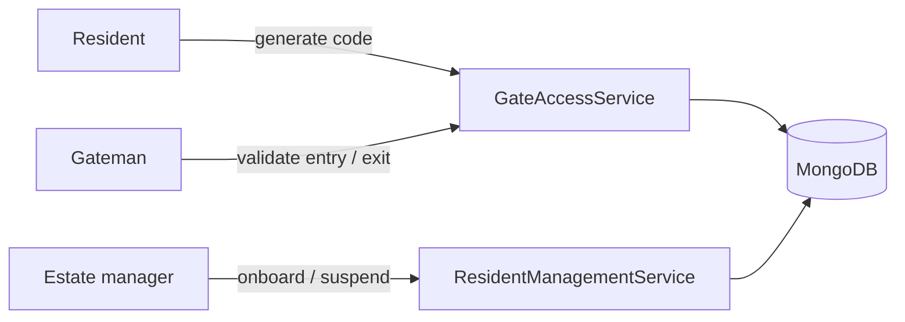

## The problem

Many gated estates still control access with a paper logbook at the gate. Residents phone the
gateman to say a visitor is coming, and nobody can check afterwards who came in or when they left.

## What I built

An API with three roles: estate manager, resident and gateman.

- **Estate manager:** onboards residents and can suspend them.
- **Resident:** generates a one-time entry code for themselves or a visitor (with visitor details
  recorded), and can extend or disable a code.
- **Gateman:** validates entry codes. An entry code is exchanged for a new exit code, which is
  validated when the visitor leaves.

## Architecture

## Key engineering decisions

- **Codes are single-use.** A validated code is marked invalid immediately, so it can't be
  replayed at the gate.
- **Entry and exit are separate code types.** An exit code can only be generated from an entry
  code, and the gateman validates against the expected type.
- **Codes from `SecureRandom`.** Eight-character alphanumeric codes come from a cryptographically
  secure generator rather than `Math.random`. Codes expire after five hours by default.
- **Suspended residents can't issue codes.** This is checked before any gate pass is created.
