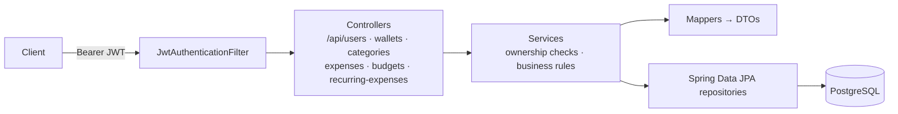

## The problem

Most people track spending in their heads or in a spreadsheet, so they can't easily answer
basic questions. How much came in this month? How much went out? How much of that was fixed
(rent, subscriptions) and how much was discretionary (food, data, transport)? Am I over budget?

## What I built

A JWT-secured REST API where each user manages their own money data:

- **Wallets** in Naira, Dollar, Euro or Pounds, with a computed balance (total inflow minus total outflow).
- **Categories** that users create, such as Salary, Rent, Data or Food. Each one is typed as
  `INFLOW`, `OUTFLOW_FIXED_COST` or `OUTFLOW_VARIABLE_COST`. Shared default categories exist alongside personal ones.
- **Transactions** recorded against a wallet and category, with amount, date, note and payment method (cash, transfer, POS).
- **Budgets** per category, plus a *budget vs actual* report.
- **Recurring expenses** with a frequency (daily to yearly) and a next due date.
- **Reports:**
  - a monthly summary (total income, total expenses, net amount), with fixed and variable outflow tracked separately
  - a per-category breakdown, computed with an aggregate JPQL query

## Architecture

The code is layered: controllers, services, repositories and entities. Request and response
DTOs and dedicated mappers keep JPA entities from leaking into the API.

## Key engineering decisions

**The category type drives the reports.** Each category carries a `TransactionType`, so a
transaction doesn't need its own direction flag. The monthly summary groups by the category's
type. Fixed and variable outflow come out of the same query without extra bookkeeping.

**Money is `BigDecimal` with `NUMERIC(19,2)`.** I never use floating point for currency, at the Java
or the database level.

**Public UUIDs on every resource.** Entities keep an internal `Long` primary key for joins, and a
separate immutable `publicId` (UUID) is exposed in URLs. Clients can't enumerate other users'
wallets or expenses by guessing IDs.

**Ownership checks in the service layer.** Every read and write resolves the current user from
the security context. It then checks that the wallet or category belongs to them, returning
`403` if not, before touching the data.

**Deleting a category doesn't delete history.** When a user removes a category, their
transactions are reassigned to a shared *Uncategorized* category in a single bulk update, so
past totals stay correct. Default categories can't be deleted.

**Integration-tested end to end.** The test suite has around 170 test cases. It covers the
service layer and the full HTTP layer (MockMvc with a real PostgreSQL test database and
`create-drop` schema), including the auth and ownership failure paths.

## Trade-offs

- `ddl-auto=update` is fine for development. Before production I'd move schema changes to
  versioned migrations (Flyway), as I did in Vero.
- Recurring expenses store their schedule (frequency and next due date). Turning them into
  real transactions on the due date is a scheduled job I'd add next.
