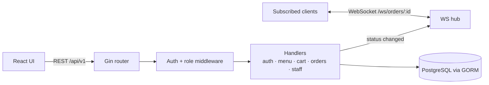

## The problem

A restaurant taking orders online needs two views of the same data. Customers browse a menu,
build a cart and want to know where their order is. Staff need a live queue of today's orders and
a quick way to move each one along, without the two getting out of sync.

## What I built

- **Customer flow:** register and log in, browse the menu by category, manage a cart, and
  place a delivery or pickup order.
- **Staff flow:** a dashboard of today's orders, status updates, and menu management (create
  and edit items, toggle availability, add categories).
- **Status push:** a WebSocket endpoint per order (`/ws/orders/:id`). When staff change an
  order's status, the API pushes the updated order to every client subscribed to it.
- **React front end:** customer pages (menu, cart, order tracking, history) and a staff
  dashboard. Routes are protected by auth and role.

## Architecture

## Key engineering decisions

**Order status is an explicit state machine.** Allowed transitions live in one map
(`RECEIVED → PREPARING → READY → DELIVERED | PICKED_UP`, with cancellation only before
`READY`). An invalid jump returns `422` along with the transitions that *are* allowed, which
makes the staff UI easy to build correctly.

**Placing an order is one transaction.** Cart items are copied into order items with the unit
price *at the time of ordering*, and the cart is cleared in the same database transaction. If the
menu price changes later, past orders still show what the customer paid.

**A small hub instead of a framework.** The WebSocket hub is a goroutine that owns a map of
order ID to clients. Register and unregister go through channels, broadcasts take a read lock,
and slow clients are dropped instead of blocking the broadcaster.

**Role-based routing at the router level.** Public, customer and staff routes are separate Gin
groups with their own middleware. A staff-only endpoint can't accidentally go unprotected.

## Trade-offs

- The React order-tracking page currently uses polling (every five seconds, stopping at a final
  state) rather than the WebSocket. Polling is simpler and survives flaky mobile connections.
  Switching the page to the existing socket endpoint is a small front-end change.
- Schema management uses GORM `AutoMigrate`, which is quick for a project this size but not
  something I'd use for a production schema.
