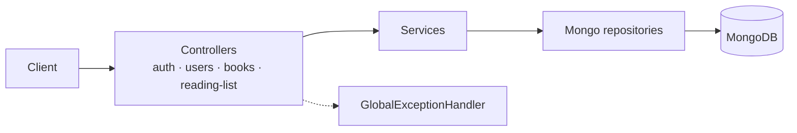

## What I built

- **Catalogue:** admins add, update and remove books (checked against the user's role). Anyone can browse and search.
- **Reading lists:** each user keeps their own list, tracks status (want to read, reading, done)
  and rates books.
- **Accounts:** registration, login, profile and password updates.

## Architecture

## Key engineering decisions

- **Integration tests over mocks.** Over 30 `@SpringBootTest` tests run the services against a
  real MongoDB, so repository queries are exercised, not just the Java logic.
- **Domain-specific exceptions.** Examples include `BookAlreadyInListException` and
  `InvalidRatingException`. One global handler turns them into consistent responses.
- **DTOs and mappers at the edge.** Persistence models never leave the service layer.
