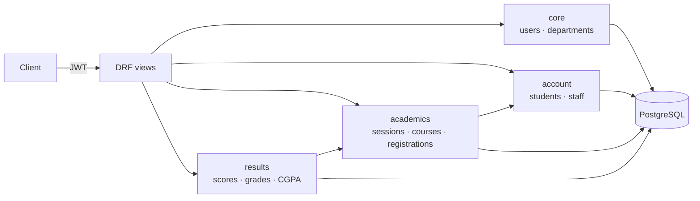

## The problem

In many universities, results are still compiled by hand. A lecturer enters scores, someone
works out grades, and CGPA is calculated in a spreadsheet. Every manual step is a chance for a
student's record to be wrong.

## What I built

A REST API that models the academic flow end to end:

- **Accounts:** a custom user model with admin, staff and student roles, and JWT login.
- **Academics:** departments, academic sessions, courses with credit units, and student and staff
  enrolment.
- **Results:** staff upload a score per course registration. The grade and grade point are
  derived automatically on save. Only *published* results are visible.
- **CGPA:** an endpoint computes a student's CGPA from their published results, weighted by
  credit units.
- **Docs:** Swagger and ReDoc UIs generated from the API.

## Architecture

The project is split into Django apps by domain. A result belongs to a *course registration*
(student + course + session), not directly to a student, so it always has full context.

## Key engineering decisions

**Grades are derived, never entered.** `Result.save()` maps the score to a letter grade and grade
point on the standard 5-point scale (A = 70+ … F < 40). Staff can't record an `A` against a score
of 52.

**Publishing is a separate step.** Results carry an `is_published` flag. Lists and CGPA only use
published results, so staff can upload and review before students see anything.

**Exact arithmetic for CGPA.** Quality points are summed with `Decimal` and rounded once at the
end (`quantize(0.01)`). This avoids floating-point drift that can move a borderline CGPA.

**Query efficiency.** Result queries use `select_related` across registration, student, course and
session, which avoids N+1 queries when listing results.

**Structured logging.** Uploads, failed validations and CGPA calculations are logged with Loguru,
with the student, course and score in each entry.
