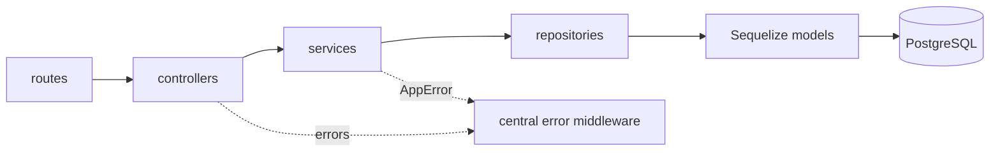

## The problem

This was a backend engineering case study: build a clean, well-reasoned CRUD API for tasks and
document the decisions behind it.

## What I built

A REST API for tasks (`/tasks`) with create, read, update, delete and a `?status=` filter. Tasks
have a title, description, status (`pending`, `in-progress`, `completed`) and due date.

## Architecture

## Key engineering decisions

- **Layered architecture.** HTTP handling, business rules and data access live in separate
  layers, so each can change or be tested on its own.
- **UUID primary keys.** IDs aren't sequential, so they can't be guessed or enumerated.
- **Validate before the database.** A malformed UUID used to surface as a raw Postgres error
  and a `500`. It's now caught in the service layer and returned as a clean `400`.
- **One error path.** A custom `AppError` and a single Express error middleware give every error
  the same response shape.
- **A constrained status enum.** Status is a fixed enum rather than free text, which keeps
  filtering predictable.
