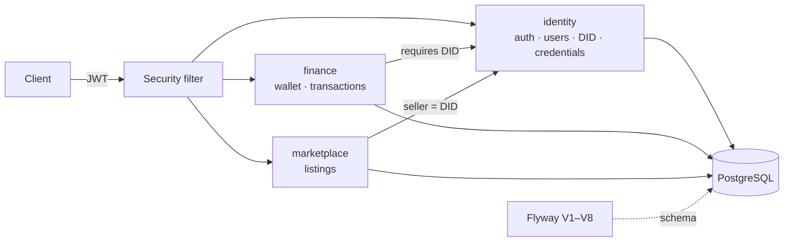

## The problem

African creatives, such as actors, crew, producers and musicians, struggle to prove who they are and
what they've done. They also struggle to get paid for rights, bookings and stakes in productions.
Vero's long-term goal is a trusted marketplace for that creative economy. The first step is a
solid backend for identity, credentials, money and listings.

## What I built

The shipped phases (1 and 2) of the core API, organised as a **modular monolith** with four
modules:

- **Identity:** registration, login and refresh tokens, and user tiers (`TIER_0` to `TIER_3`)
  with account status (active, pending, suspended, blacklisted).
- **Decentralised identifiers:** each user can mint one platform DID (`did:vero:<uuid>`), which
  becomes the anchor for everything else they own.
- **Credentials:** professional credentials (type, issuing body, expiry) issued against a DID and
  stored with a SHA-256 hash for later verification.
- **Finance:** one wallet per DID in NGN, funding, and an append-only transaction history where
  every entry records the balance after the change.
- **Marketplace:** creators create listings (tickets, rights, production stakes, talent bookings,
  collectibles). Listings start in `DRAFT`, only the owner can publish them, and they move to `ACTIVE`.

## Architecture

The code is grouped by domain (`identity`, `finance`, `marketplace`, `shared`) rather than by
technical layer. Each module can later be extracted into its own service without untangling
shared packages.

## Key engineering decisions

**The DID is the ownership anchor, not the user row.** Wallets and listings reference the DID,
not the login account. Identity (who you are) is kept separate from authentication (how you sign
in), and a wallet can't exist without a DID behind it.

**Versioned schema with Flyway.** The schema is defined in eight SQL migrations rather than
generated by Hibernate. Corrections, such as converting Postgres enums to `VARCHAR` (V3) and fixing
decimal scale on money columns (V7), are explicit, reviewable and repeatable in every environment.

**A ledger-style wallet.** Funding updates the balance and writes a `wallet_transactions` row
with `balance_after` in the same transaction. The full history can be audited and replayed
against the current balance. Money columns are `DECIMAL(19,2)`.

**Lifecycle rules in the service layer.** Only the owning DID can publish a listing, and only
from `DRAFT`. Invalid transitions return clear errors through a single exception type and a
consistent `ApiResponse` envelope.

## Scope note

This page covers what's built and working: identity, DIDs, credentials, wallet and marketplace
listings. On-chain components are not part of this release. The schema has nullable
`blockchain_tx` columns so on-chain references can be added later without a breaking migration.
